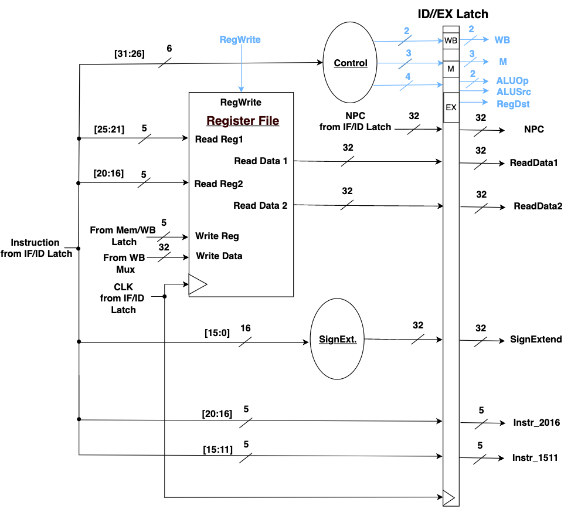
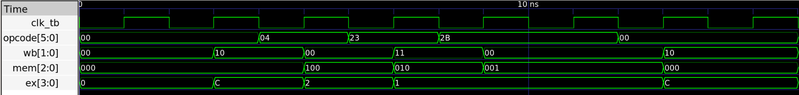
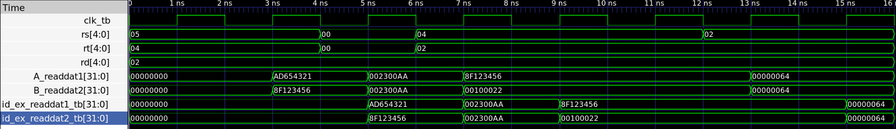

# Coding Assignment 2 — Instruction Decode (ID) Stage

ECE 4300, Fall 2026, Cal Poly Pomona.

## Design Scope and Assumptions

- **In scope:** The ID stage of a 5-stage MIPS pipeline: a 32 × 32-bit register file, the main control unit, a 16-to-32-bit sign extender, the ID/EX pipeline latch.
- **Out of scope:** The IF, EX, MEM and WB stages. The testbench drives the IF/ID and MEM/WB inputs directly.
- **Assumptions:**
  - The control unit supports four instruction types: R-format, LW, SW and BEQ.
  - Reset is active-high and synchronous.
  - Registers 0–9 are preloaded with fixed values, following the lab template.
  - The testbench clock period is 2 ns.
- **Limitations:**
  - hardcoded register values.

## Requirements

| Requirement | Description | Verification Method |
|---|---|---|
| REQ-01 | The register file shall hold 32 general-purpose 32-bit registers. | Inspection of `regfile.v` |
| REQ-02 | When `regwrite` is 1, the register file shall write `writedata` into register `rd`. | TC-05: REG[2] ← 0x64, then read back |
| REQ-03 | The register file shall output the contents of `rs` and `rt` on Read Data 1 and Read Data 2. | TC-01 to TC-04, ReadDat waveform |
| REQ-04 | The control unit shall produce the WB, M and EX control bits from the opcode, following the control table. | TC-01 to TC-04, Control waveform |
| REQ-05 | The sign extender shall extend a 16-bit immediate to 32 bits by copying bit 15. | TC-02 to TC-04, `sign_ext` output |
| REQ-06 | The ID/EX latch shall register every ID-stage output on the rising clock edge and clear to 0 on reset. | Waveform, reset interval 0–2 ns |
| REQ-07 | `decode` shall connect the submodules as shown in the ID-stage block diagram. | Inspection of `decode.v`; TC-01 to TC-05 |

## Architecture

The instruction from the IF/ID latch is split into fields:

| Bits | Goes to |
|---|---|
| `[31:26]` | Control |
| `[25:21]` | Read Reg 1 |
| `[20:16]` | Read Reg 2, and passed through the latch |
| `[15:11]` | Passed through the latch |
| `[15:0]` | Sign extender |

The register file's write port is driven from MEM/WB (`wb_write_reg_location`, `mem_wb_write_data`, `wb_reg_write`).

| Bus | Width | Bits |
|---|---|---|
| WB | 2 | RegWrite, MemToReg |
| M | 3 | Branch, MemRead, MemWrite |
| EX | 4 | RegDst, ALUOp1, ALUOp0, ALUSrc |

| Instruction | Opcode | WB | M | EX |
|---|---|---|---|---|
| R-format | `000000` | `10` | `000` | `1100` |
| LW | `100011` | `11` | `010` | `0001` |
| SW | `101011` | `00` | `001` | `0001` |
| BEQ | `000100` | `00` | `100` | `0010` |

X entries in the assignment's table are encoded as 0.

### Timing or Behavioral Summary



## Implementation

### Source Code

| File | Description |
|---|---|
| [`src/decode.v`](src/decode.v) | Top-level ID stage; instantiates and connects the four submodules |
| [`src/regfile.v`](src/regfile.v) | 32 × 32-bit register file, one write port and two clocked read ports |
| [`src/control.v`](src/control.v) | Main control unit; opcode → WB / M / EX bits |
| [`src/signExt.v`](src/signExt.v) | 16-to-32-bit sign extender (combinational) |
| [`src/idExLatch.v`](src/idExLatch.v) | ID/EX pipeline register |
| [`decodeTB.v`](decodeTB.v) | Testbench for the full ID stage |
| [`decodeTB.gcd`](decodeTB.gtkw) | GTKWave view |

## Verification

### Verification Strategy
The testbench `decodeTB.v` drives the IF/ID inputs (`if_id_instr`, `if_id_npc`) and the MEM/WB inputs (`wb_reg_write`, `wb_write_reg_location`, `mem_wb_write_data`). It applies one new instruction every 2 ns clock cycle. Instruction encodings come from the [MIPS Instruction Converter](https://mips-converter.jeffsieu.com).
 
| Time applied | Instruction | Encoding |
|---|---|---|
| 0 ns (reset until 2 ns) | `ADD $v0, $a1, $a0` | `0x00a41020` |
| 4 ns | `BEQ $zero, $zero, 0x8` | `0x10000008` |
| 6 ns | `LW $v0, 2($a0)` | `0x8c820002` |
| 8 ns | `SW $v0, 2($a0)` | `0xac820002` |
| 10 ns | write `REG[2] ← 0x64` (`wb_reg_write` = 1) | — |
| 12 ns | `ADD $v0, $v0, $v0` | `0x00421020` |

Verification covers:

- **Normal operation:** R-format, BEQ, LW and SW, each checked for control bits, register reads, sign extension and register fields.
- **Reset:** reset is held high for the first cycle; all latch outputs read 0.

### Testbench and Waveform




The testbench source is available [here](decodeTB.v).

### Results

Values are the ID/EX latch outputs.

| Test Case | Expected Result | Observed Result | Status |
|---|---|---|---|
| TC-00 — Reset | All latch outputs 0 | All 0 at t = 2 ns | Pass |
| TC-01 — `ADD $v0, $a1, $a0` (0x00a41020) | wb=10, m=000, ex=1100; rd1 = REG[5] = AD654321; rd2 = REG[4] = 8F123456; rt=4, rd=2 | wb=2, m=0, ex=C; rd1=AD654321, rd2=8F123456; rt=4, rd=2 | Pass |
| TC-02 — `BEQ $zero, $zero, 0x8` (0x10000008) | wb=00, m=100, ex=0010; rd1 = rd2 = REG[0] = 002300AA; se=00000008 | wb=0, m=4, ex=2; rd1=rd2=002300AA; se=00000008 | Pass |
| TC-03 — `LW $v0, 2($a0)` (0x8c820002) | wb=11, m=010, ex=0001; rd1 = REG[4] = 8F123456; rd2 = REG[2] = 00100022; se=00000002 | wb=3, m=2, ex=1; rd1=8F123456, rd2=00100022; se=00000002 | Pass |
| TC-04 — `SW $v0, 2($a0)` (0xac820002) | wb=00, m=001, ex=0001; same reads and immediate as TC-03 | wb=0, m=1, ex=1; rd1=8F123456, rd2=00100022; se=00000002 | Pass |
| TC-05 — Write REG[2] ← 0x64, then `ADD $v0, $v0, $v0` (0x00421020) | wb=10, ex=1100; rd1 = rd2 = 00000064 | wb=2, ex=C; rd1=rd2=00000064 at t = 16 ns | Pass |

## Reproduction Instructions

### Tools and Versions

- **Simulator:** Icarus Verilog 12.0 (`iverilog` and `vvp`)
- **Waveform viewer:** GTKWave
- **Language:** Verilog
- **Operating system:** Any
- **Additional dependencies:** none

### Build and Run

`decode.v` includes its submodules with `` `include "src/..." ``. Run these commands from the folder that contains `src/`, and pass only `decode.v` and the testbench to `iverilog`; listing the submodule files as well declares them twice.

```bash
iverilog -o decodeTB decode.v decodeTB.v && vvp decodeTB.vvp && gtkwave decodeTB
```
## Repository Organization

```text
.
├── README.md
├── images/
│   ├── decode_control.png
│   └── decode_readdat.png
├── src/
│   ├── regfile.v
│   ├── control.v
│   ├── signExt.v
│   └── idExLatch.v
├──decode.v
└──decodeTB.v
```